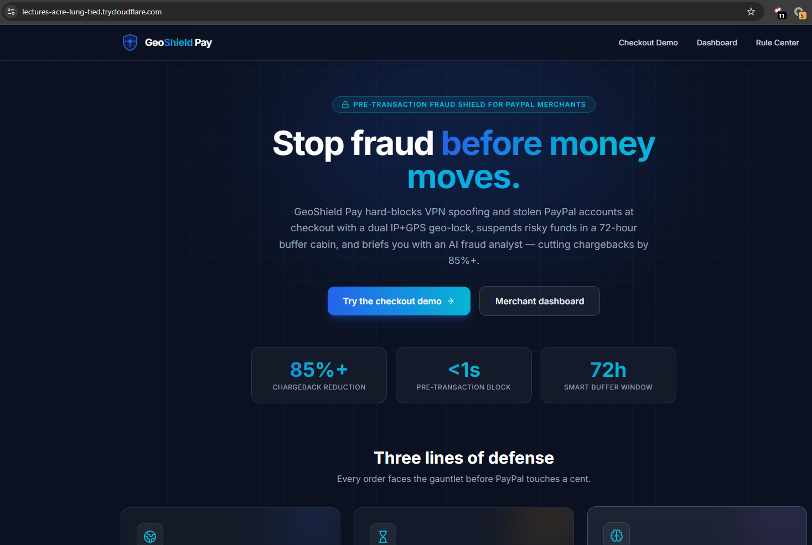
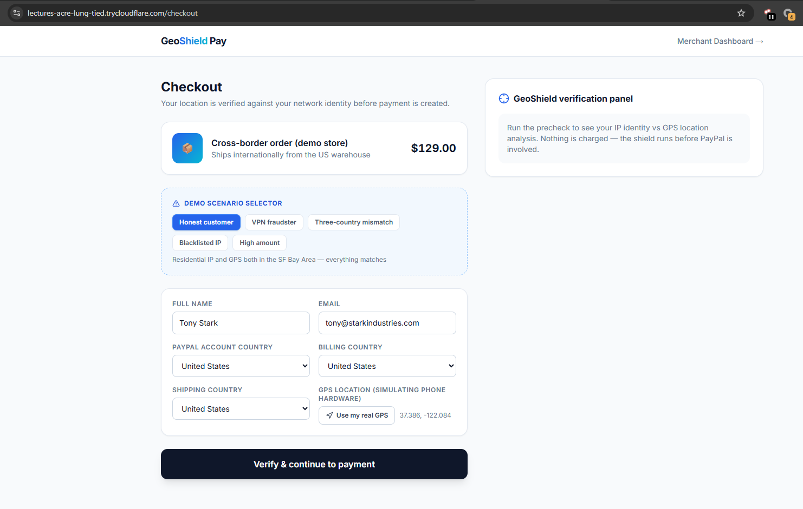
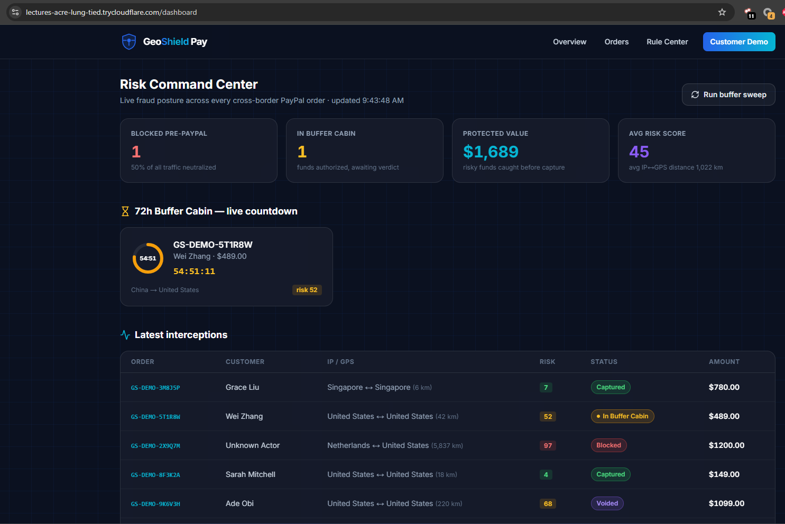

# GeoShield Pay

**Pre-transaction fraud shield for PayPal cross-border merchants** — built for the
[PayPal AI Hackathon](https://paypalaihackathon.devpost.com/).

GeoShield Pay stops fraud **before money moves**: a dual **IP + GPS geo-lock** hard-blocks VPN
spoofing and stolen PayPal accounts at checkout, a **72-hour smart buffer cabin** suspends risky
funds using PayPal `AUTHORIZE` instead of capturing, and an **AI Risk Analyst** (LLM) writes a
plain-language fraud report for every single order — cutting chargebacks by 85%+ and protecting
the merchant's PayPal account health.

## Demo

**▶ Watch the 2-minute demo (one continuous take, unedited):** https://youtu.be/GatrPGfM5H0

Every interception in that film is a real `POST /api/risk/precheck` that wrote an order to the
database, and the AI report is a live DeepSeek call triggered on screen. The recording pipeline
lives in `scripts/video/` — see [`demo/README.md`](demo/README.md).

**Landing** — the shield's value proposition at a glance:



**Checkout** — GPS + IP verification panel with the deterministic demo scenario selector
(honest customer, VPN fraudster, three-country mismatch, blacklisted IP, high amount):



**Merchant dashboard** — Risk Command Center: pre-PayPal blocks, live 72h buffer-cabin countdown,
and every interception with its risk score:



## Inspiration

Every cross-border merchant we talked to has the same war story: a stolen PayPal account, a VPN
exit node in another country, a shipping address that never matched the billing country — and by
the time the chargeback lands, the goods are gone and the money is clawed back with a penalty on
top. Worse, repeated chargebacks quietly devalue the merchant's PayPal account itself.

The frustrating part is *when* the industry fights back: after the money moved. Disputes,
evidence uploads, "seller protection" claims. We kept asking a simpler question — why does PayPal
even need to capture the money before anyone has checked whether the person holding the phone is
where they claim to be? That question became GeoShield Pay.

## What it does

GeoShield Pay is a pre-transaction risk shield that sits between the checkout button and the PayPal
order. It has three lines of defense:

1. **Dual Geo-Lock** — at checkout the browser shares its device GPS; the server resolves the
   request IP's real location. If the two disagree by more than a configurable tolerance, or the IP
   belongs to a VPN/proxy/hosting network, the order is **hard-blocked before a PayPal order is
   even created**. The fraud attempt never touches the payment network.
2. **72-hour Smart Buffer Cabin** — when the PayPal account country, billing country and shipping
   country disagree, the order is not captured. It is authorized with PayPal's `AUTHORIZE` intent,
   which suspends the funds, and a live 3-day countdown starts. The customer confirms → `capture`.
   They reject, or the timer runs out → the watchdog `void`s the authorization and releases the
   money automatically.
3. **AI Risk Analyst** — an LLM reads the full signal chain for every order and writes a 0–100 risk
   score plus a human-readable fraud report in English and Chinese, so a merchant can understand
   *why* an order was stopped instead of trusting a black box.

A **Visual Rule Center** lets merchants tune tolerance, thresholds, and country/IP black- and
whitelists; rules hot-reload into the engine in under a second, no restart required.

## How we built it

- **Framework**: Next.js 14 App Router + TypeScript, one deployable — API routes and dashboard in
  the same codebase.
- **PayPal**: Orders API v2 with `intent=AUTHORIZE` for create/authorize, Payments API for
  `capture` and `void`, all server-side with an OAuth token cache and `PayPal-Request-Id`
  idempotency keys. The frontend uses `@paypal/react-paypal-js` buttons.
- **Geo signals**: browser Geolocation API for hardware GPS, ip-api.com for IP geolocation,
  proxy/hosting detection and coordinates, BigDataCloud reverse geocoding to turn coordinates into
  a country, and a Haversine distance check server-side. IP lookups are cached for an hour.
- **Risk engine**: a deterministic, in-memory evaluator (whitelist → blacklist → amount →
  geo-lock → three-country mismatch) that returns a verdict in milliseconds. It runs before the
  PayPal call, so a block costs nothing.
- **AI layer**: any OpenAI-compatible chat-completions model, prompted with the structured signal
  chain and forced into JSON output. The call is fire-and-forget with a 20-second timeout; if it
  fails, a deterministic rule-based report is stored instead, so the demo never breaks.
- **Data**: Prisma + SQLite for orders, reports, rules and an append-only audit trail; `node-cron`
  scans every minute for expired authorizations and voids them.
- **Demo controls**: a scenario selector on the checkout page (honest, VPN fraudster, three-country
  mismatch, blacklisted IP, high amount) plus a `DEMO_MODE` header override so any fraud path can
  be reproduced deterministically in front of judges.

## Challenges we ran into

- **Whitelist bypass was a fraud vector.** Our first rule engine let a whitelisted *country* skip
  all checks — and our Tor exit node test promptly passed because it geolocated to a whitelisted
  country. We rewrote the fast-path so a whitelist match only short-circuits when there are no geo
  red flags; otherwise the full evaluation still runs.
- **Datacenter IPs look like VPNs.** Our first "honest customer" demo IP, `8.8.8.8`, is flagged as
  hosting infrastructure — the shield correctly blocked our own good customer. We now demo with a
  residential IP and treat the proxy signal as a confidence input, not an absolute truth.
- **Static prerendering broke live data.** Next.js prerendered `/api/stats` and `/api/rules` at
  build time, so the dashboard froze on its first snapshot. `force-dynamic` fixed it.
- **PayPal's authorize → capture → void lifecycle has sharp edges.** Capture must happen within the
  authorization window, and voiding an already-captured authorization returns an error instead of
  silence. We made capture/void idempotent and treat "already settled" as a no-op.
- **Making GPS demonstrable.** Real GPS and a real IP can never be made to disagree on demand, so
  we built the scenario harness: coordinates are sent as the device GPS would send them, and the IP
  is overridden *only* in demo mode.
- **Keeping AI off the critical path.** Every "just call the model inline" version made checkout
  feel slow or fragile. Moving the analyst to an async, fallback-capable job was the fix.

## Accomplishments that we're proud of

- **Blocking fraud before a PayPal order exists.** Not "flagged for review" — the fraudster never
  reaches PayPal's checkout, so there is nothing to dispute.
- **Chargebacks are structurally impossible on intercepted orders.** Blocked, voided and expired
  transactions never captured a cent.
- **A real PayPal primitive doing real work.** The buffer cabin is not a mock timer: it is
  `AUTHORIZE` + scheduled `void`, the exact lifecycle PayPal exposes to merchants.
- **Sub-second rule hot reload** with a live "effective now" badge, proven by blacklisting a
  country and watching the very next checkout get blocked.
- **An AI analyst that explains itself** in two languages and degrades gracefully instead of taking
  the payment flow down with it.
- **A demo that works without credentials** — every risk path is reproducible with seeded data and
  rule fallback reports.

## What we learned

- **Pre-authorization is an underused risk lever.** Most fraud tooling argues about a payment after
  capture. Suspending funds for 72 hours turns a dispute into a simple timeout.
- **AI belongs in explanation, not in the blocking decision.** The deterministic engine decides in
  milliseconds and is auditable; the LLM turns that decision into something a merchant can read.
  Mixing the two makes both worse.
- **Geo signals need context.** Datacenter IPs, CGNAT, corporate VPNs and traveling customers all
  look like fraud if you only compare two dots on a map. Confidence and tolerance matter more than
  hard rules.
- **Demo reproducibility is engineering.** Half our build time went into making each fraud scenario
  deterministic — and that work is also what makes the system testable.

## What's next for GeoShield Pay

- **PayPal webhooks** for authorization expiry, capture and refund events, so state is reconciled
  with PayPal instead of inferred.
- **Device fingerprinting** (canvas, timezone, language, battery) to complement IP + GPS with a
  third, harder-to-spoof dimension.
- **Chargeback feedback loop**: feed dispute outcomes back into the rule engine and the AI prompt so
  the shield learns a merchant's specific adversary profile.
- **Shared rule cache** (Redis) so hot reload and rate limits work across horizontally scaled
  instances instead of one process.
- **Shopify / WooCommerce plugins** and a hosted API so a merchant can adopt it without touching
  checkout code.
- **Merchant-facing analytics**: risk trends by corridor, false-positive tracking, and the estimated
  dollars saved per rule.

## The three lines of defense

| Capability                       | What it does                                                                                                                                                                                                                                                                                                                               | PayPal tech used                                                                                            |
| -------------------------------- | ------------------------------------------------------------------------------------------------------------------------------------------------------------------------------------------------------------------------------------------------------------------------------------------------------------------------------------------ | ----------------------------------------------------------------------------------------------------------- |
| **Dual Geo-Lock**          | Compares the customer's IP geolocation against their device GPS on every checkout. Proxy/VPN/hosting networks and >500 km mismatches are **hard-blocked before a PayPal order is ever created**.                                                                                                                                     | Orders API v2 (`intent=AUTHORIZE`)                                                                        |
| **72h Smart Buffer Cabin** | When the account / billing / shipping countries mismatch, funds are authorized (suspended, not captured) and a 3-day countdown opens. Customer confirms → `capture`. Rejects or times out → automatic `void`, funds released, zero dispute risk.                                                                                     | Orders API v2 + Payments API (`authorize` / `capture` / `void`), idempotent via `PayPal-Request-Id` |
| **AI Risk Analyst**        | An LLM reads every risk signal chain (IP↔GPS distance, proxy flags, three-country mismatch, amount, cart profile) and produces a 0–100 risk score plus a bilingual (EN/ZH) fraud analysis stored on each order. Runs **fully async** — it never blocks the payment path and falls back to rule scoring if the LLM is unavailable. | Any OpenAI-compatible LLM API                                                                               |
| **Visual Rule Center**     | Merchants tune thresholds and country/IP black- & whitelists; saved rules **hot-reload into the engine in under a second** — no restart, no redeploy.                                                                                                                                                                               | —                                                                                                          |

## Architecture

```
Checkout (GPS + form) ──► /api/risk/precheck ──► IP geo (cached) + rule engine  ──► BLOCK: stop, no PayPal call
                                                            │ PASS / BUFFER
                                                            ▼
                                              /api/paypal/create-order (AUTHORIZE)
                                                            │ buyer approves
                                                            ▼
                                     authorize ──► PASS: capture now · BUFFER: 72h cabin
                                                            │
                     confirm (capture) ◄── 72h cabin ──► reject / timeout (void, node-cron watchdog)
                                                            │
                                     AI analyst (async LLM) ──► report + score stored per order
```

## Quick start

### 1. Prerequisites

- Node.js 18+
- PayPal **sandbox** credentials: create a free account at
  [developer.paypal.com](https://developer.paypal.com/dashboard/applications/sandbox) and copy the
  Client ID / Secret
- (Optional) an OpenAI-compatible API key for the AI analyst — without it the system falls back to
  rule-based scoring and stays fully functional

### 2. Configure

```bash
cp .env.example .env
# then fill in PAYPAL_CLIENT_ID, PAYPAL_CLIENT_SECRET and (optionally) AI_API_KEY
```

### 3. Run

```bash
npm install
npx prisma db push      # creates the SQLite database
npm run db:seed         # loads 6 realistic demo orders + default rules
npm run dev             # http://localhost:3000
```

### 4. Demo script (2 minutes)

1. **/checkout** — pick the *Honest customer* scenario → precheck passes → pay with the PayPal
   sandbox button → captured immediately.
2. Pick the *VPN fraudster* scenario → the shield shows a Tor/proxy IP 5,800+ km from the GPS and
   **hard-blocks before any PayPal order exists** (check the dashboard: no PayPal order id).
3. Pick the *Three-country mismatch* scenario → payment is **authorized but suspended** in the 72h
   buffer cabin with a live countdown.
4. **/dashboard** — see KPIs, the live countdown card stream, then open the order: full signal
   chain timeline + the AI fraud report (EN/ZH toggle). Capture or Void with one click.
5. **/dashboard/rules** — e.g. tighten the distance tolerance or blacklist a country, hit
   *Save & hot-reload*, and the very next checkout is evaluated under the new rules.

> Demo scenarios send a `x-demo-ip` header (enabled by `DEMO_MODE=true`) so judges can reproduce
> each fraud path deterministically. GPS comes from the browser Geolocation API; Chrome DevTools →
> Sensors can override it. Set `DEMO_MODE=false` for production.

## AI usage disclosure (Devpost requirement)

- **Model**: any OpenAI-compatible chat-completions endpoint (default `gpt-4o-mini`), configured
  via `AI_BASE_URL` / `AI_MODEL` / `AI_API_KEY`.
- **Purpose**: the AI Risk Analyst receives the structured signal chain for each order and returns
  JSON with `{ score, verdict, reportEn, reportZh }`. It is decision support for merchants, not an
  autonomous actor — the deterministic rule engine always makes the blocking decision first.
- **Resilience**: 20-second timeout; on failure a deterministic rule-based report is stored instead
  (`source=RULE_FALLBACK`), so the demo works even without a key.

## Tech stack

Next.js 14 (App Router) · TypeScript · Tailwind CSS · Prisma + SQLite ·
`@paypal/react-paypal-js` + PayPal Orders/Payments REST APIs (sandbox) · ip-api.com (+ BigDataCloud
reverse geocoding) · node-cron buffer watchdog · LLM risk analyst

## Deployment (Render)

This repo ships a `render.yaml` blueprint: create a **New Blueprint** on
[Render](https://dashboard.render.com), point it at this repo, and fill in the sync'd secrets
(`PAYPAL_CLIENT_ID`, `PAYPAL_CLIENT_SECRET`, `AI_API_KEY`). Render builds, pushes the schema and
starts the app automatically.

## Self-hosted deployment (Docker + Cloudflare Tunnel)

The production demo runs in Docker with **no public ports opened on the host** — the app is only
reachable through an outbound Cloudflare quick tunnel:

```bash
docker compose up -d --build          # builds the standalone image, seeds demo data, starts app + tunnel
docker compose logs tunnel | grep trycloudflare.com   # grab the public demo URL
```

- `app` — multi-stage build (`node:20-alpine`), Next.js standalone output, SQLite persisted in the
  `geoshield-data` volume, capped at 400 MB RAM. Schema push + demo seeding happen at image build.
- `tunnel` — `cloudflared` quick tunnel (`trycloudflare.com` URL, no account/ports needed). Quick
  tunnel URLs rotate on restart; use a Cloudflare named tunnel for a stable domain.
- Secrets (`PAYPAL_CLIENT_ID/SECRET`, `AI_API_KEY`) are injected via environment; without them the
  app runs fully in demo mode with rule-based fallback scoring.

## Project layout

```
src/
  app/                  # pages: landing, checkout, dashboard, orders, rule center
    api/                # precheck · paypal (create/authorize/capture/void) · buffer · rules · orders · stats
  lib/
    geo/                # IP geolocation cache + haversine geo-lock
    risk/               # rule engine + LLM analyst
    paypal/             # REST client (token cache, idempotency keys)
    buffer/             # 72h watchdog (node-cron)
  components/           # gauge, countdown rings, badges, nav
prisma/                 # Order / RiskReport / RuleConfigRow / AuditLog
scripts/seed.ts         # demo data generator
```

## License

MIT — see [LICENSE](LICENSE).
